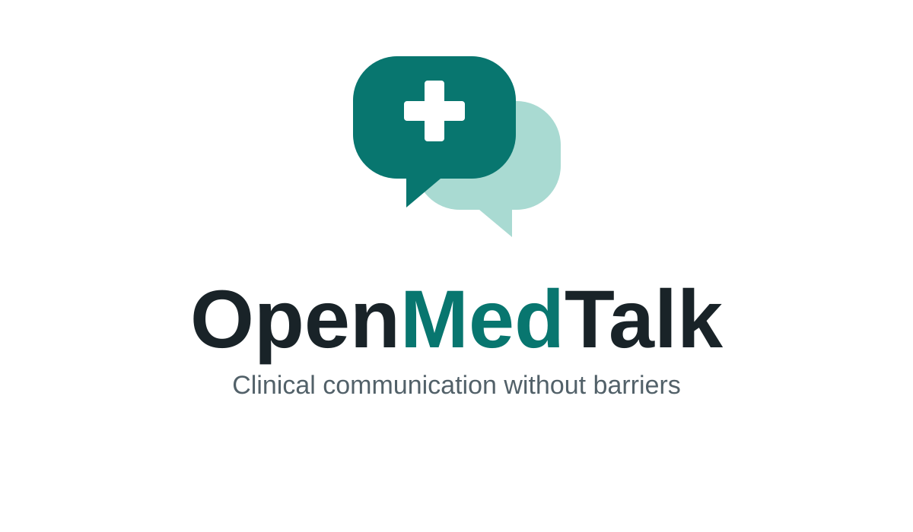

# OpenMedTalk

**Clinical communication without barriers.**

An open-source, offline-first, fixed-phrase communication aid for acute healthcare across languages and countries. The official application is intended to remain free, without advertising or subscriptions.

**Status: planning and clinical content draft. Not for patient use.** No working mobile application or validated translation catalog is represented by this repository yet.

## Start here

For contributors and coding agents, read [AGENTS.md](AGENTS.md) first, then:

| Document | Scope |
| --- | --- |
| [Product specification](docs/PRODUCT.md) | Agreed workflow, screens, log and scope |
| [Design system](docs/DESIGN.md) | UI rules, accessibility and palette |
| [Architecture](docs/ARCHITECTURE.md) | Mobile, data, QR and editorial portal |
| [Clinical content](docs/CLINICAL.md) | 45 locales, human validation and release gates |
| [Implementation plan](docs/IMPLEMENTATION.md) | Ordered milestones and acceptance tests |
| [Clinical source draft](docs/clinical/source-library-v0.1.draft.json) | 561 bilingual items; not approved |
| [Brand assets](assets/brand/README.md) | Logo and design tokens |
| [Design references](docs/design/references/README.md) | Reference image inventory; original PNG upload pending |

Start with milestone 0. Do not treat the mockups as a clinical specification or the seed data as validated. The latest written requirements override the original draft and artwork.

## Principles

One question at a time. No patient identification, patient history, remote patient data, clinical decision support or generated summaries. Patient language and clinician UI language are separate. The clinical log contains literal questions and answers. Qualified interpreters remain necessary when clinically appropriate.

## License

The repository is currently under [Mozilla Public License 2.0](LICENSE). Separate licenses for data, documentation and portal code are proposed in [governance](GOVERNANCE.md), pending explicit maintainer approval. The official project name and logo are not intended to be licensed as trademarks; legal clearance remains pending.

Do not submit patient information in issues, pull requests or translation submissions.
